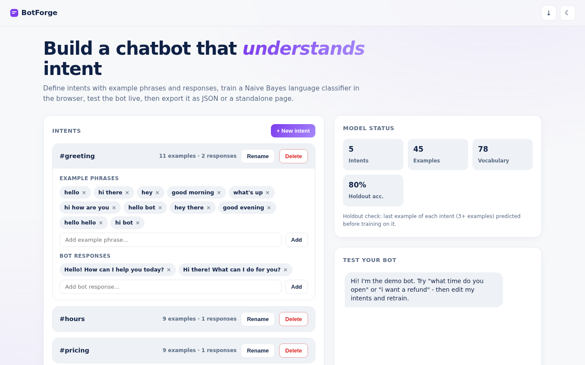
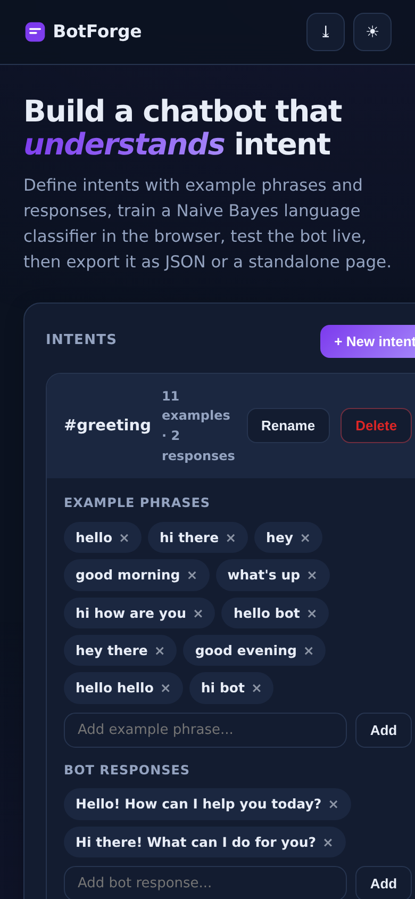

# BotForge - Visual NLP Chatbot Builder

Design intents, train a **Naive Bayes language classifier live in the browser**, test your bot in a chat console, and export it as JSON or a fully standalone HTML bot. No server, no API keys.

**Live demo:** https://akash991833.github.io/nlp-chatbot-builder/

## Features

- **Visual intent editor** - create, rename, delete intents; add/remove example phrases and responses; collapsible cards; persisted to localStorage
- **Real NLP classifier** - Naive Bayes over unigram + bigram features with stopword filtering and Laplace smoothing
- **Holdout validation** - the last example of each intent is held out before training, and the reported accuracy is measured on it honestly
- **Live test console** - chat bubbles with per-response confidence scores and a graceful low-confidence fallback
- **Export JSON** - full bot definition, re-importable
- **Export standalone bot** - a single self-contained HTML file with the trained model baked in, ready to share or host anywhere
- **PWA** - installable, offline-capable
- **Premium UI** - white professional design, navy ink, violet accent, dark + light themes, responsive desktop and mobile

## Screenshots

## Honest limits

Bag-of-words Naive Bayes is an intent router, not an LLM. It needs 5+ examples per intent and will not hold open-ended conversations. This is stated inside the app, and the accuracy metric is measured honestly on held-out examples.

## Tech

Vanilla HTML/CSS/JS, zero dependencies, zero network calls.

## Run locally

Open `index.html` or serve the folder (`python3 -m http.server`).
